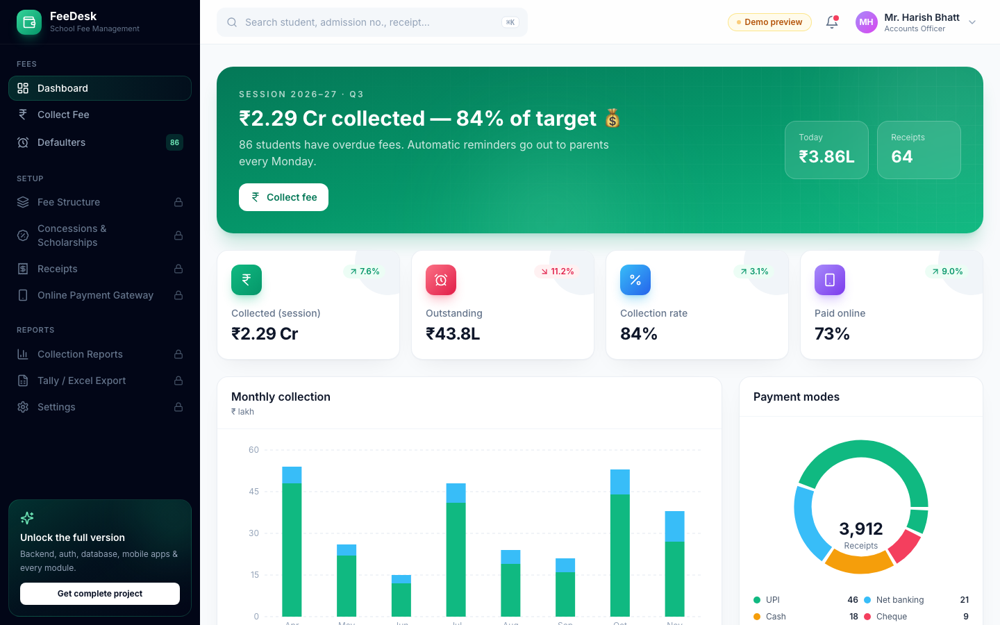
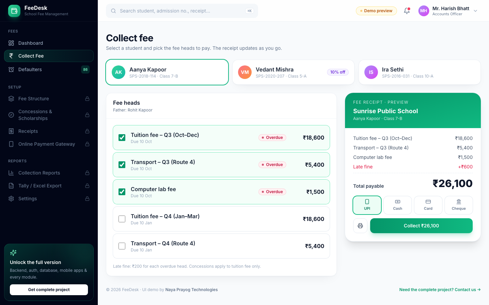
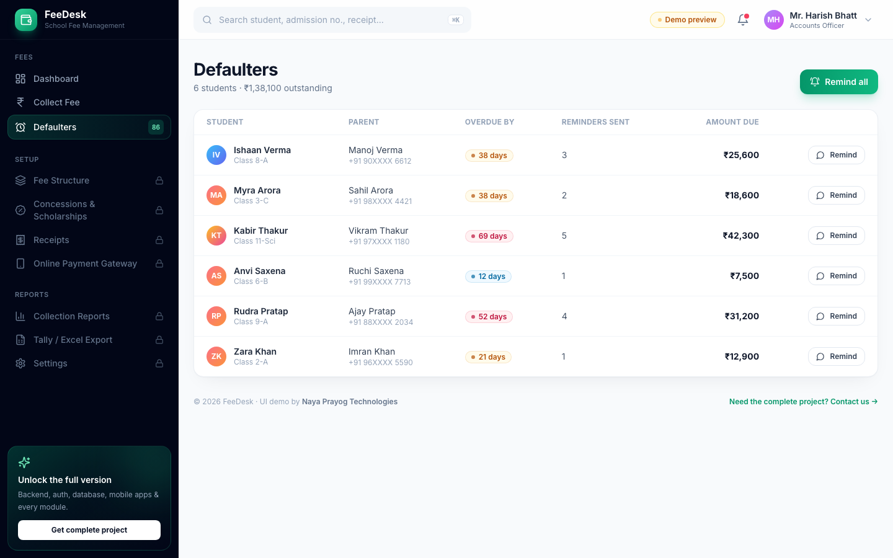

# School Fee Management Software | School Fee Collection System Development

**Naya Prayog Technologies** provides custom **School Fee Management Software Development** services for schools, educational institutions, and academic organisations.

Our solutions are designed to help schools streamline fee collection, student fee records, installment management, outstanding payments, fee receipts, concessions, and financial reporting through a centralised digital platform.

Whether you manage a small school or a multi-branch educational organisation, we can develop a fee management system around your institution's financial workflows.

## What Is School Fee Management Software?

School Fee Management Software is a digital solution that helps educational institutions manage student fees and financial transactions efficiently.

It can simplify fee structures, student-wise payments, monthly and annual fee collection, installment tracking, pending dues, payment receipts, and financial reports.

Naya Prayog Technologies develops customised school fee management systems to reduce manual administration and improve visibility into fee-related operations.

## Key Features and Modules

The following features can be included depending on the agreed project requirements.

### 1. Student Fee Management

- Student-wise fee records
- Class and section-wise fee allocation
- Academic session management
- Student fee account history
- Fee status tracking
- Pending and paid fee records
- Student-wise financial summaries

### 2. Fee Structure Management

- Class-wise fee structures
- Course and academic session fee configuration
- Admission fee management
- Tuition fee configuration
- Annual and miscellaneous charges
- Transport and activity fee categories
- Custom fee heads and categories

### 3. Fee Collection Management

- Daily fee collection records
- Monthly and annual fee collection
- Student-wise payment entries
- Cash, bank transfer, and digital payment records
- Payment reference tracking
- Collection summaries
- Date-wise collection reports

### 4. Installment Management

- Full and partial fee payments
- Monthly installment plans
- Quarterly and half-yearly installments
- Custom installment schedules
- Installment due-date tracking
- Remaining balance calculation
- Payment history

### 5. Outstanding Fee and Due Management

- Pending fee identification
- Student-wise outstanding balances
- Class-wise due reports
- Overdue payment tracking
- Defaulter reports
- Due-date monitoring
- Late fee configuration where required

### 6. Fee Receipt and Invoice Generation

- Digital fee receipts
- Student payment receipts
- Receipt number generation
- Payment date and transaction details
- Printable receipts
- Downloadable PDF receipts
- Receipt history and verification

### 7. Fee Discounts and Concessions

- Student-specific fee concessions
- Sibling discounts
- Scholarship adjustments
- Custom discount rules
- Fee waivers
- Discount approval workflows
- Concession history

### 8. Online Fee Payment Integration

An online payment facility can be integrated to allow parents or students to pay fees digitally.

Potential capabilities include:

- Online fee payment
- Payment gateway integration
- Transaction status tracking
- Payment confirmation
- Digital payment receipts
- Failed transaction handling
- Payment reconciliation

Payment gateway availability depends on the selected provider and integration requirements.

### 9. Parent and Student Portal

A parent or student portal can provide access to relevant fee information, including:

- Total applicable fees
- Paid fee details
- Pending fee balance
- Upcoming installments
- Payment history
- Digital receipts
- Online payment access
- Fee-related notifications

### 10. Reports and Financial Dashboard

- Total fee collection reports
- Daily, monthly, and annual collection
- Class-wise fee collection
- Student-wise payment reports
- Pending fee reports
- Outstanding balance summaries
- Discount and concession reports
- Payment method summaries
- Academic session comparisons

### 11. Notifications and Reminders

Notifications can be configured for:

- Upcoming fee due dates
- Pending fee reminders
- Successful payment confirmation
- Installment reminders
- Payment receipt notifications
- Parent communication

SMS, email, and messaging integrations can be considered based on the required providers.

### 12. Admin and Staff Management

- Administrator dashboard
- Fee collection staff accounts
- Role-based access
- Permission management
- Collection activity tracking
- Financial report access
- Academic session configuration

## Who Can Use School Fee Management Software?

Our custom software development services can support:

- Private schools
- Public and independent educational institutions
- CBSE and ICSE schools
- State board schools
- Primary and secondary schools
- Senior secondary schools
- Multi-branch school organisations
- Educational trusts and groups

## Custom School Fee Management Software Development

Every institution follows different fee policies, payment schedules, and administrative procedures.

Naya Prayog Technologies can develop a customised fee management platform according to your school's requirements.

Possible solutions include:

- Web-based school fee management software
- Android and iOS parent applications
- Online fee collection systems
- Student fee portals
- Multi-branch fee management
- Custom financial dashboards
- Payment gateway integration
- Automated fee reminders
- School ERP integration

The final modules and integrations depend on the agreed project scope.

## Integration with School Management Software

A fee management system can also be developed as part of a broader School Management System or integrated with an existing school ERP.

This can help connect fee records with:

- Student admission records
- Class and section information
- Academic sessions
- Parent accounts
- Student dashboards
- School administration
- Financial reports

## EduSuite – Education Management Solution

**EduSuite by Naya Prayog Technologies** is our broader education management solution for educational institutions.

Explore the platform:

**Website:** https://nayaprayog.com/edsuite/

Schools can discuss requirements for student administration, attendance, fees, examinations, certificates, learning resources, and related academic workflows. Available modules depend on the selected implementation and configuration.

## Why Choose Naya Prayog Technologies?

- Custom school fee management software
- Solutions tailored to institutional workflows
- Web and mobile application development
- Centralised financial administration
- Scalable software architecture
- Payment and notification integrations where required
- Custom reporting and analytics
- Project-specific development and support

We focus on building practical software solutions that help educational institutions simplify administration and manage their operations more effectively.

## Our Education Software Development Services

- School Fee Management Software Development
- School Management System Development
- School ERP Software Development
- Student Management System Development
- College Management Software Development
- Coaching Institute Management Software
- Learning Management System (LMS) Development
- Education Mobile App Development
- Custom Education Software Development

## Frequently Asked Questions

### What is school fee management software?

It is software that helps schools manage fee structures, student payments, installments, outstanding dues, receipts, discounts, and financial reports.

### Can the software manage monthly school fees?

Yes. Monthly fee schedules, installment plans, due dates, and payment records can be configured according to the school's fee policy.

### Can parents pay school fees online?

Online payment functionality can be integrated using a suitable payment gateway, subject to provider availability and project requirements.

### Can the system generate fee receipts?

Yes. Digital and printable fee receipts can be included, with payment details and receipt history.

### Can the software track pending school fees?

Yes. Student-wise and class-wise pending fee reports, outstanding balances, and overdue payment tracking can be developed.

### Can you integrate fee management with an existing school ERP?

Yes. Integration can be planned based on the existing software's architecture, APIs, and data structure.

### Do you develop custom school fee management software?

Yes. Naya Prayog Technologies develops customised education software based on institutional requirements and agreed project scope.

## Discuss Your School Fee Management Project

Looking for reliable **School Fee Management Software Development** services?

Contact Naya Prayog Technologies to discuss your school's requirements, fee workflows, integrations, and custom software development needs.

**Naya Prayog Technologies**

- Website: https://nayaprayog.com/
- Email: [support@nayaprayog.com](mailto:support@nayaprayog.com)
- Phone / WhatsApp: +91 7991327022
- WhatsApp: https://wa.me/917991327022
- Portfolio: https://github.helloharendra.io

**Simplify fee collection. Improve financial visibility. Manage school fees digitally.**

---

## Repository Information

This repository showcases Naya Prayog Technologies' school fee management software development services and potential solution capabilities.

For customisation, pricing, implementation, or integration enquiries, contact our team.

**Note:** This repository is a proprietary service and solution showcase. It does not grant permission to redistribute, resell, or commercially use Naya Prayog Technologies' proprietary materials or intellectual property.

<!-- screenshots -->
## Screenshots

**Dashboard**

<table>
  <tr>
    <td align="center" width="50%"><b>Collect</b>  </td>
    <td align="center" width="50%"><b>Defaulters</b>  </td>
  </tr>
</table>
